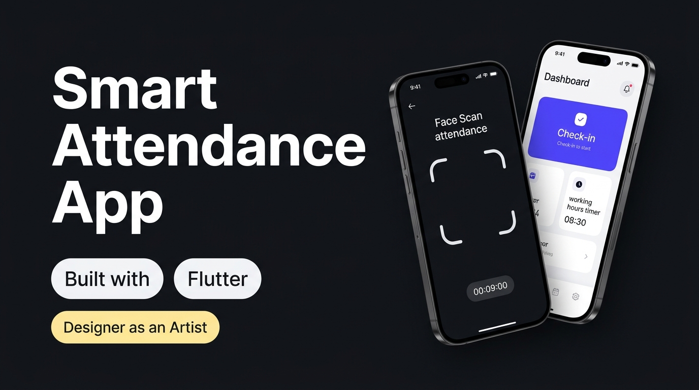

# 📱 Smart Biometric Attendance & Workforce Productivity App

<div align="center">
  

  <p align="center">
    <strong>A next-generation mobile attendance and workforce productivity solution engineered with Flutter.</strong>
  </p>

  <p align="center">
    <a href="#-key-features">Key Features</a> •
    <a href="#-tech-stack">Tech Stack</a> •
    <a href="#-getting-started">Getting Started</a> •
    <a href="#-app-architecture">Architecture</a> •
    <a href="#-creator">About the Creator</a>
  </p>

  <p align="center">
    
    
    
    
    
  </p>
</div>

---

## 💡 About the Project

Traditional corporate attendance applications often feel rigid, outdated, and frustrating to use. This project reimagines modern workforce management by combining **rock-solid biometric engineering** with an **expressive, aesthetic Bento Grid design**.

> *"Code is the canvas, and user interface is the visual art."*  
> — **Muhammad Dzaky Abdillah a.k.a JEKI** (*Designer as an Artist*)

---

## 🔥 Key Features

- 📸 **Pure On-Device Biometric Face Detection**
  - Instant on-device face verification using local machine learning models (zero external cloud API keys required).
  - Strict anti-spoofing logic: if no face is visible, check-in is rejected with a shake animation and alert dialog.
  - Automatically captures verified **Selfie Photo Proof** upon successful scan.

- ⏱️ **Live Working Hours Timer**
  - Real-time ticking shift timer (`HH:MM:SS`) tracking elapsed work duration.
  - Interactive progress bar calculating percentage toward the standard 8-hour shift and remaining time.

- 🍱 **Modern Bento Grid Dashboard**
  - 2x2 Bento overview cards: **Check-in**, **Check-out**, **Break**, and **Overtime**.
  - High-contrast electric indigo primary accent with dark & clean surfaces.

- 🗺️ **GPS Geotagging & Radar Map**
  - Real-time location radar verifying user coordinates against the registered office perimeter.
  - Visual activity cards displaying mini maps for each attendance check.

- 📊 **Gamified Attendance Score & Monthly Heatmap**
  - GitHub-style color-coded contribution calendar tracking On-Time, Late, Overtime, and Leave status.
  - Discipline score (out of 100) with streak achievement badges (*Discipline Master*, *5-Day Streak*).

- 🧾 **Digital Attendance Slip & Export**
  - Downloadable official attendance slips with unique QR code verification.
  - One-click copy & export to **CSV** and formatted text for HR and payroll reporting.

- 🏖️ **Leave & Permit Portal**
  - Paperless request submission for **Sick Leave**, **Annual Leave**, **Remote / WFH**, and **Official Duty** with real-time quota tracking.

- 🃏 **Interactive 3D Flip Creator Pass**
  - Dedicated *"About Me"* showcase featuring a 3D rotating ID card, kudos appreciation counter, and creator philosophy.

---

## 🛠️ Tech Stack & Dependencies

| Layer | Technologies / Packages |
|---|---|
| **Framework** | Flutter 3.x (Dart 3.x) |
| **Biometrics & Vision** | Google ML Kit Face Detection / Local Vision Engine |
| **Location & Maps** | Geolocator, Geocoding, Flutter Map |
| **UI & Typography** | Google Fonts (Manrope), Custom Bento Cards, Glassmorphism, 3D Matrix Transforms |
| **State Management** | Provider / Reactive Component State |
| **Storage & Data** | SharedPreferences / In-Memory Mock Repository |

---

## 🚀 Getting Started

### Prerequisites
- [Flutter SDK](https://flutter.dev/docs/get-started/install) (v3.0.0 or higher)
- Android Studio / VS Code with Flutter extension
- Android SDK (API level 21+) or Chrome (for Flutter Web)

### Installation

1. **Clone the repository:**
   ```bash
   git clone https://github.com/Jeki-Miau/Attendance-App.git
   cd Attendance-App
   ```

2. **Install dependencies:**
   ```bash
   flutter pub get
   ```

3. **Run on your device / emulator:**
   ```bash
   # Run on Chrome (Web)
   flutter run -d chrome

   # Run on connected Android device
   flutter run
   ```

4. **Build release executable / APK:**
   ```bash
   # Build Android Release APK
   flutter build apk --release

   # Build Flutter Web
   flutter build web --release
   ```

---

## 📱 Quick Demo Accounts

For instant testing and presentation, the app includes 1-click credentials on the Sign In screen:
- **Muhammad Dzaky Abdillah** (ID `#8101` • *Designer as an Artist*) — `jeki@office.id` / `password123`
- **Chandra Pratama** (ID `#8152` • *Senior Product Lead*) — `chandra@office.id` / `password123`
- **Nadia Putri** (ID `#8190` • *UX Researcher*) — `nadia@office.id` / `password123`
- **Budi Santoso** (ID `#8204` • *Fullstack Engineer*) — `budi@office.id` / `password123`

---

## 👨‍🎨 Creator

**Muhammad Dzaky Abdillah a.k.a JEKI**  
*Creative Product Designer • Visual Artist • Flutter Developer*  
Tagline: *"Designer as an Artist"*

---

## 📄 License
This project is open-source and available under the [MIT License](LICENSE).
